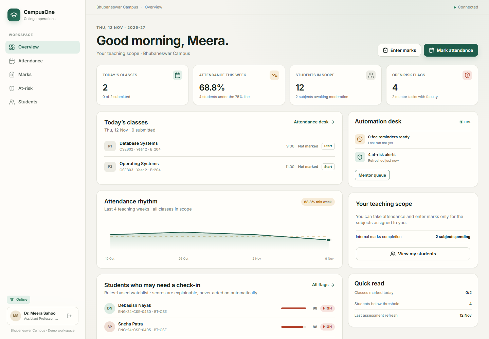

# CampusOne

**Repository:** https://github.com/dipeshkumar123/campusone

CampusOne is a college ERP core slice built for a take-home brief: attendance that works when the network does not, internal marks with a real moderation gate, a fee collection desk, an explainable at-risk watchlist, and a read-only assistant that shows its query plan.

The demo is a single-campus workspace for **Bhubaneswar Campus** with 23 synthetic students across B.Tech CSE, B.Tech Mechanical and MBA. No real student data is used.



## What is included

- **Offline-first attendance** for faculty: cached rosters, a device outbox, idempotent sync, 14-day corrections and a full-roster rule.
- **Internal marks and moderation**: faculty drafts out of 40, admin-only lock after completeness checks, reason-required unlock, audit trail and CSV export.
- **Fee desk**: outstanding dues, mock test payments with idempotency and receipts, reminder candidates, Odia/English mock SMS copy and Tally CSV export.
- **Risk watchlist**: transparent points model, HIGH/MEDIUM bands, reasons on every card, auto-created mentor tasks for new HIGH flags only, no automatic changes to attendance, marks or fees.
- **Ask CampusOne**: admin-only, deterministic, read-only natural-language slice with refused write verbs, clarification paths and a visible SQL-style plan. No external AI provider receives student records.
- **Student 360**: attendance by subject, internal marks, fee position, guardian consent, risk snapshot and mentor task.
- **Roles and scope**: office admin and faculty, server-enforced access to assigned programmes and subjects.
- **PWA shell**: responsive desktop/mobile layouts, installable manifest and service worker for static assets.

## Stack

| Layer | Technology |
| --- | --- |
| API | Java 21 target, Spring Boot 3.3.5, Spring Security, Spring Data JPA |
| Database | H2 file database for the demo, in-memory H2 for tests |
| Auth | Stateless HMAC JWT, BCrypt passwords, login throttling |
| Web | React 18, TypeScript 5.7, Vite 5, React Query 5, React Router 6 |
| UI | Hand-built design system, Inter variable font, lucide icons |
| Tests | JUnit 5, MockMvc, Vitest, Testing Library, Playwright Chromium |

## Run locally

### Option A: one deployable jar

```powershell
cd web
npm ci
npm run build

cd ..\backend
mvn -q -DskipTests package
java -jar target\campusone.jar
```

Open http://localhost:8080. The Maven build copies `web/dist` into the jar, and the Spring app serves the SPA and `/api` from one origin.

### Option B: development servers

Terminal 1:

```powershell
cd backend
mvn spring-boot:run
```

Terminal 2:

```powershell
cd web
npm ci
npm run dev
```

Open http://localhost:5173. Vite proxies `/api` to the backend on port 8080.

## Demo accounts

| Role | Email | Password |
| --- | --- | --- |
| Office admin | `admin@campusone.demo` | `Campus@2026` |
| Faculty | `faculty@campusone.demo` | `Faculty@2026` |

The login screen can fill either account with one click.

## Tests and verification

```powershell
cd backend
mvn test

cd ..\web
npm test
npm run build
```

Current evidence:

- 35 backend tests pass across API integration, attendance, marks, fees, risk scoring and assistant parsing.
- 14 frontend tests pass for formatting, the offline outbox and the login screen.
- 15-step Playwright smoke flow passes against the dev server with no page errors, console errors, HTTP 4xx or HTTP 5xx responses.
- The packaged jar serves the built SPA and passes a production login/dashboard smoke check.

Screenshots from the verified flow are in [docs/screenshots](docs/screenshots).

## Documentation

- [Technical Design Document (PDF)](docs/CampusOne_TDD.pdf)
- [Technical Design Document source](docs/TDD.md)
- [Deployment guide](deployment.md)

## Repository layout

```text
backend/   Spring Boot API, domain model, seed data and tests
web/       React SPA, offline outbox, PWA assets and tests
docs/      Technical design and verified screenshots
```

## Demo data and reset

The backend seeds demo data on first boot when the database is empty. To reset locally, stop the app, delete `backend/data/campusone.mv.db` and `backend/data/campusone.lock.db`, then start it again.

The fee payment screen is deliberately in test mode. It records a mock receipt and never contacts a payment gateway or SMS provider.
