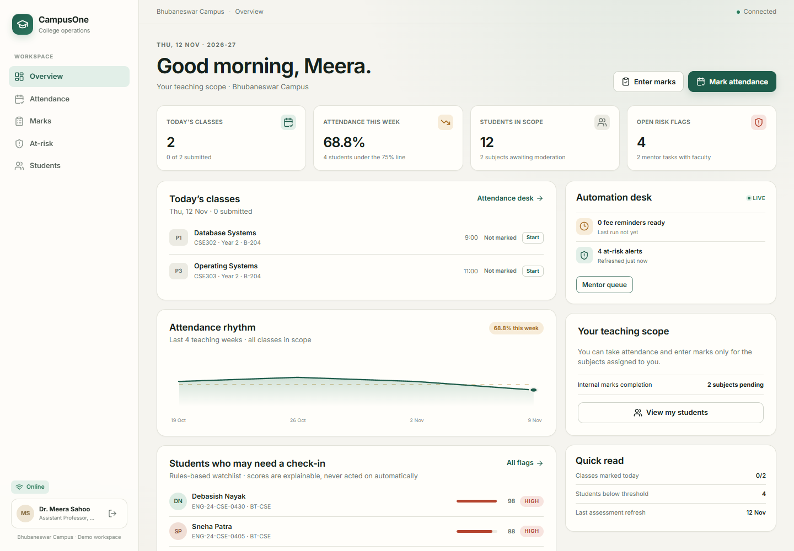
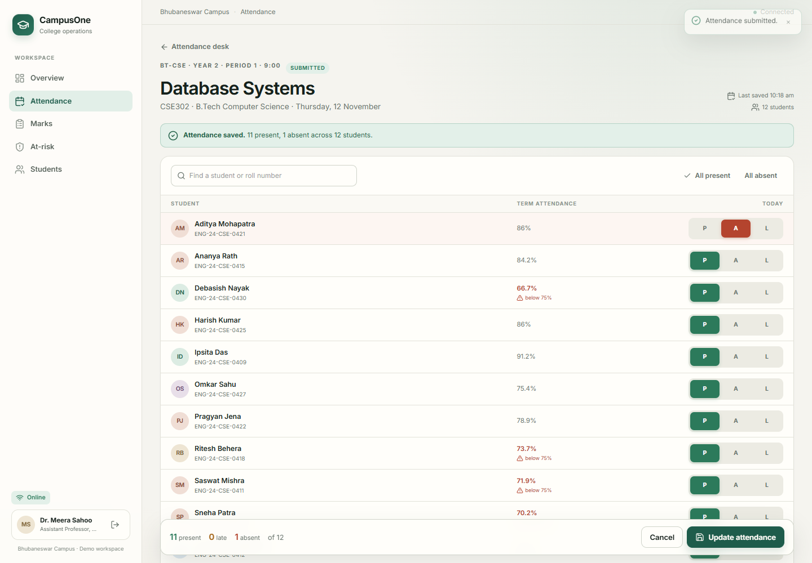
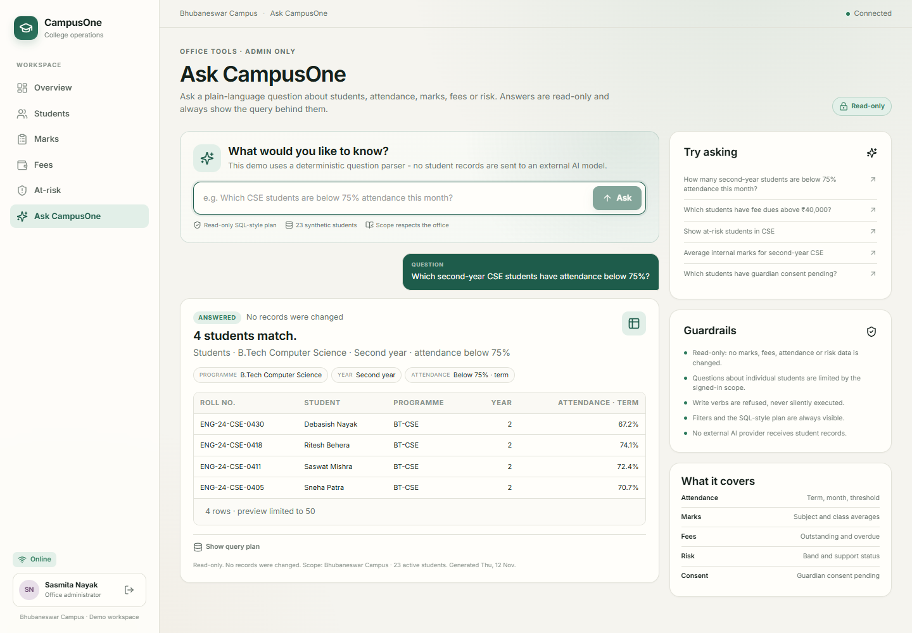
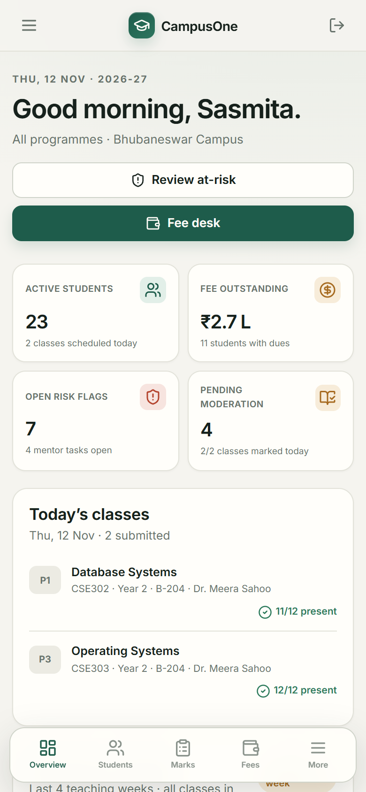

# CampusOne

## Technical Design Document

**A calm operating layer for a busy campus.**

Dipesh Kumar Panjiyar · 12 November 2026

Repository: **[https://github.com/dipeshkumar123/campusone](https://github.com/dipeshkumar123/campusone)**

---

## 1. Executive summary

CampusOne is a working college ERP core slice. It focuses on the daily work that breaks first in a real campus: taking attendance when the network is unreliable, keeping internal marks honest until moderation, collecting fees with a traceable receipt, and surfacing students who need support without silently changing their records.

The submission is a two-role application for a single-campus demo (Bhubaneswar Campus) with 23 synthetic students across B.Tech CSE, B.Tech Mechanical and MBA. It is intentionally deeper than a set of CRUD screens: every write has a rule, a role check and an audit trail; the assistant is read-only by construction; and the offline attendance path protects against duplicate submissions.

**What is verified:**

- 35 backend tests pass.
- 14 frontend tests pass.
- A 15-step browser smoke flow passes with no page errors, console errors, HTTP 4xx or HTTP 5xx responses.
- The frontend is bundled into the Spring Boot jar and passes a production login/dashboard smoke check.

**Design principles:**

1. **The server is the source of truth.** The client may cache a roster, but the server validates the full roster, the date window and the role.
2. **Offline is an explicit state, not an accident.** The UI says when it is working from the device, queues the class, and shows the sync outcome.
3. **Moderation is a gate, not a label.** Locked marks cannot be edited; unlocking requires the office and a reason.
4. **Support signals explain themselves.** Risk scores show their inputs and reasons, and only create a mentor task.
5. **The assistant cannot write.** It is a deterministic query surface with a visible plan, not an opaque chatbot.

## 2. Brief interpretation and scope

### 2.1 Interpretation

The brief asks for a functional slice rather than a full ERP. I chose to build one complete campus workflow instead of shallow screens for every department. The slice is:

- Faculty attendance, including offline capture and correction.
- Faculty internal marks, with an office moderation gate.
- Office fee collection and follow-up.
- A risk watchlist that turns academic signals into a mentor workflow.
- A read-only assistant for common office questions.
- A student 360 view that joins the above without duplicating data entry.

### 2.2 Assumptions

| Assumption | Reason |
| --- | --- |
| One campus is seeded | Depth and correctness matter more than a campus switcher in a take-home. The `Campus` entity and user campus scope remain in the model. |
| Two roles: office admin and faculty | This is the smallest role split that exercises real permission boundaries. |
| Three programmes and two years | Enough variety to test scoping, filtering and realistic joins. |
| Fee payments are mock/test mode | A real gateway would add external dependencies without proving the domain rules. |
| The assistant is deterministic | Student data must not leave the application, and a bounded parser is easier to test and explain. |
| Data is synthetic | No real student, guardian or payment data is present. |
| A single application instance is enough for the demo | The file database and in-memory login throttle are intentionally simple; production extraction is documented. |

### 2.3 Non-goals

- Student or guardian login.
- Admissions, timetable generation, examinations or hostel workflows.
- Live payment gateway, SMS/email delivery or WhatsApp integration.
- A general-purpose LLM over student records.
- Multi-tenant campus isolation across many campuses.
- Schema migrations for a production database.
- Horizontal scaling of the API.

## 3. Product surface

| Area | Faculty | Office admin | Key behaviour |
| --- | --- | --- | --- |
| Dashboard | Scoped overview | Campus-wide overview | Today's classes, attendance rhythm, risk preview, moderation queue, fee follow-up |
| Attendance | Take, correct, queue offline | Read-only review | Full roster, 14-day backfill, no future dates, idempotent sync |
| Internal marks | Draft marks for assigned subjects | Lock/unlock moderation | Completeness check before lock, reason required to unlock, audit trail |
| Fees | No access | Collect, remind, export | Mock payment idempotency, receipt number, Tally CSV |
| At-risk | View scoped flags, complete assigned tasks | View all, recompute, create tasks | Explainable score, HIGH band auto-creates one mentor task |
| Ask CampusOne | No access | Read-only query | Refuses writes, clarifies ambiguity, shows plan and preview |
| Students | Scoped directory and 360 | Campus directory and 360 | Attendance by subject, marks, fees, risk and consent |

The interface is responsive and installable as a PWA. The same information architecture collapses to a bottom navigation on mobile.

## 4. Architecture

### 4.1 System shape

```text
+---------------------------------------------------------------+
| Browser                                                       |
| React 18 + TypeScript + Vite + React Query + PWA shell        |
| localStorage: JWT, user, roster cache, attendance outbox      |
+----------------------------+----------------------------------+
                             | HTTPS /api (JWT bearer)
                             v
+---------------------------------------------------------------+
| Spring Boot 3.3 modular monolith                              |
|                                                               |
|  Controllers  ->  Services  ->  Repositories  ->  JPA         |
|       |              |              |                         |
|       |              +-- AccessService / AuditService         |
|       |              +-- AcademicMetricsService               |
|       |              +-- RiskScoringModel / QuestionParser    |
|       |                                                       |
|  Security: stateless JWT filter, method-level role checks      |
|  Errors: one JSON envelope via GlobalExceptionHandler          |
+----------------------------+----------------------------------+
                             |
                             v
+---------------------------------------------------------------+
| H2 file database (demo) / in-memory H2 (tests)                |
| Campus, User, Programme, Student, Subject, TeachingSlot,       |
| AttendanceSession, AttendanceRecord, MarksComponent,           |
| MarkEntry, ModerationState, FeeAccount, Payment, RiskFlag,     |
| MentorTask, AuditEvent                                         |
+---------------------------------------------------------------+
```

In production the built SPA is copied into `BOOT-INF/classes/static/`, so the jar serves both the UI and `/api` from one origin. During development, Vite runs on `5173` and proxies `/api` to `8080`.

### 4.2 Why a modular monolith

The workflows share strong transactional invariants: a marks lock must see every mark entry; a fee payment must update the account and create exactly one receipt; a risk recompute must update flags and possibly create a task. A modular monolith keeps those invariants inside one transaction and one deployable artifact. For this scale it is simpler and safer than distributed services. The package boundaries (`api`, `service`, `domain`, `repo`, `config`, `common`) make later extraction possible without changing the domain language.

### 4.3 Request flow

1. The React client calls a typed wrapper in `web/src/lib/api.ts`.
2. The JWT filter validates the token and builds an `AuthenticatedUser` principal.
3. The controller validates the request DTO.
4. The service applies role, scope and domain rules.
5. Repositories persist the change and the audit service records high-impact writes.
6. A DTO is returned; entities are never serialized directly.
7. React Query invalidates the affected views and the UI updates.

### 4.4 Important build decision

The Maven `prepare-package` phase copies `web/dist` into the backend's `static` directory before the jar is assembled. This gives one deployable artifact without a separate static host. The backend still runs independently in development when no frontend build exists.

## 5. Domain model

### 5.1 Relationships

```text
Campus 1---* User
Campus 1---* Programme
Programme 1---* Student
Programme 1---* Subject
Subject 1---* TeachingSlot *---1 User (faculty)
Subject 1---* MarksComponent
Subject 1---1 ModerationState

Subject 1---* AttendanceSession *---1 User (faculty)
AttendanceSession 1---* AttendanceRecord *---1 Student

Student 1---* MarkEntry *---1 MarksComponent
Student 1---1 FeeAccount 1---* Payment
Student 1---1 RiskFlag 1---* MentorTask *---1 User (assignee)
AuditEvent is an append-only record keyed by entity type and id.
```

### 5.2 Invariants and where they live

| Invariant | Enforcement |
| --- | --- |
| One attendance session per subject/date/period | Database unique constraint plus service lookup |
| One idempotency key maps to one attendance session | Database unique constraint; duplicate request returns the existing result |
| A sync contains every active student in the roster exactly once | Service validates count, duplicates and membership |
| Attendance cannot be future-dated or older than 14 days | Service checks against the injected `AcademicCalendar` |
| Only assigned faculty can take attendance or save marks | `AccessService.requireTeachSubject` |
| Admins cannot take attendance or enter marks | Same service method rejects admin role |
| Marks are 0..component max and unique per student/component | Request validation plus database unique constraint |
| All marks must exist before moderation lock | `MarksService.lock` counts missing entries |
| A lock is admin-only and an unlock requires a reason | Method-level checks, request validation and audit |
| A payment reference is unique and idempotent | `Payment.reference` unique constraint and service lookup |
| A payment cannot exceed the outstanding amount | BigDecimal comparison before write |
| One risk flag per student | Database unique constraint |
| A HIGH flag creates at most one auto task when it first appears | `RiskService.recomputeInternal` only calls `autoTask` for new HIGH flags |
| Risk recompute never changes attendance, marks or fees | Service only writes flags and tasks |
| Assistant never executes writes | Parser refuses write verbs; service exposes only read methods |
| Audit entries are append-only | No update/delete path in the application |

### 5.3 State machines

**Attendance session**

```text
not submitted -> submitted
submitted     -> corrected (same session, new audit entry)
```

**Marks moderation**

```text
DRAFT -> LOCKED -> DRAFT (reason recorded) -> LOCKED
```

**Risk flag**

```text
new HIGH/MEDIUM -> OPEN -> ACKNOWLEDGED (task created) -> RESOLVED when score < 50
```

A resolved flag can be opened again by a later recompute if the student crosses the threshold.

**Mentor task**

```text
OPEN -> DONE
```

## 6. Key workflows

### 6.1 Attendance and offline sync

1. Faculty opens the attendance desk. The date defaults to today and is constrained to the last 14 days.
2. The roster endpoint returns students, their term attendance and any existing session.
3. The page presets every unmarked student to PRESENT, which matches the common case and reduces taps.
4. The client caches the roster under `campusone.roster.{subjectId}.{date}.{period}`.
5. Submit sends the full roster with a generated `clientId`.
6. If the network is unavailable, the payload is stored in `campusone.attendance.outbox.v1`.
7. On reconnect, the outbox flushes one item at a time. A ref lock prevents StrictMode or a double mount from starting two flushes at once.
8. The server returns `duplicate: true` for a retry with the same `clientId`, or updates the session for a genuine correction.
9. The queue item is removed only after a successful response.

The full-roster rule is deliberate. It prevents a saved class from looking complete when only the first half of the room was marked.

### 6.2 Internal marks and moderation

Seed components are IA-1 out of 15, IA-2 out of 15 and Assignment out of 10, for a total of 40. Faculty can save drafts for assigned subjects. The sheet shows completeness, total, attendance below threshold and the audit trail.

Locking:

- Only an office admin can lock.
- Every student/component pair must be present.
- A lock records the actor, time and optional note.
- Further drafts are rejected with a conflict error.

Unlocking:

- Only an office admin can unlock.
- A non-blank reason is required.
- The previous lock metadata is retained; unlock metadata is added.
- The action is written to the audit trail.

CSV export includes all components, total out of 40 and attendance percentage.

### 6.3 Fees

The fee desk is office-only. It shows billed, collected, outstanding, collection rate, defaulters and reminder candidates. A payment:

- requires an idempotency key from the client;
- returns the existing receipt if the key was already used on the same account;
- rejects an amount above the outstanding balance;
- creates a readable receipt number;
- updates the account and writes an audit event;
- is explicitly labelled as test mode in the API and UI.

Reminders mark candidate accounts with a last-reminder timestamp so the same account is not queued twice on the same day. The response includes English and Odia mock SMS copy. Tally export emits UTF-8 CSV with a BOM for spreadsheet compatibility.

### 6.4 Risk scoring

The score is deliberately simple and inspectable:

```text
attendancePart = clamp((90 - attendance%) / 25 * 45, 0, 45)
marksPart      = clamp((75 - marks%) / 30 * 45, 0, 45)
trendPart      = clamp(-trendDelta * 0.5, 0, 10)
score          = round(attendancePart + marksPart + trendPart)

HIGH   >= 70
MEDIUM >= 50
LOW    < 50
```

Attendance at or below 65% contributes the full 45 points. Internal marks at or below 45% contribute the full 45 points. A four-class attendance drop of 20 points contributes the maximum 10 trend points. Reasons are generated for attendance below 75%, marks below 60% and a drop of at least 8 points.

Only two side effects exist:

1. A new HIGH flag creates one mentor task for a faculty member in the student's programme.
2. A task can be marked done by its assignee or an admin.

The recompute never edits attendance, marks or fees. That separation is important: a support signal must not silently become an academic penalty.

### 6.5 Ask CampusOne

The assistant is a deterministic, read-only slice, not an LLM wrapper.

Supported intents:

- attendance below a cutoff, term or month;
- internal marks below a percentage or a score out of 40;
- fee dues above an amount or any outstanding dues;
- at-risk students;
- guardian consent pending;
- averages and counts;
- programme and study-year filters.

Safety behaviour:

- Write verbs are refused with an explanation of where the action belongs.
- Out-of-scope programmes (for example Pharmacy) get a clarification, not a fabricated answer.
- Ambiguous cutoffs ask a follow-up question.
- Every answer includes filter chips, an interpretation, a query plan and a row preview capped at 50.
- Only office admins can call it.
- The response states that no records were changed.

### 6.6 Student 360

The profile joins attendance by subject, marks by subject and component, fee position for admins, risk snapshot, guardian consent and the latest mentor task. It reuses the same metrics service as the dashboard and assistant, so the same student does not show different attendance percentages on different screens.

## 7. Offline design

### 7.1 Data kept on the device

| Key | Contents | Cleared on logout |
| --- | --- | --- |
| `campusone.token` | JWT | Yes |
| `campusone.user` | Display user | Yes |
| `campusone.roster.*` | Last roster for a class | Yes |
| `campusone.attendance.outbox.v1` | Pending attendance payloads | Yes |

The roster cache is written after a successful load and read only if the live request fails. The UI marks the page as working from the device when this happens.

### 7.2 Why localStorage

The demo needs a small, synchronous store that survives reloads and is easy to inspect. The payloads are small (a class roster) and there is no binary data. IndexedDB would be the next step for larger caches or background sync, but it would add complexity without changing the domain proof.

### 7.3 Idempotency end to end

- The client creates one UUID per submit.
- The outbox keeps that UUID across retries.
- The server stores the UUID on the attendance session.
- A retry with the same UUID returns the existing session, counts and `duplicate: true`.
- A genuine correction uses a new UUID and updates the existing subject/date/period session.

The client also serializes flushes with a ref lock. The database unique constraint is the final guard if two requests still race.

### 7.4 Limits

- The cache is per browser and per device; it is not shared between faculty devices.
- The app does not implement service-worker background sync. A queued class syncs when the attendance page is opened while online.
- A queued class older than 14 days is rejected by the server and remains visible as an error; the office must correct it.
- Signing out intentionally removes local drafts so a shared device does not leak another teacher's roster.

## 8. Security and access control

### 8.1 Authentication

- Passwords are hashed with BCrypt.
- Login returns a stateless HMAC JWT with `uid`, `role`, `name`, issuer and expiry.
- The token lifetime defaults to 12 hours and is configurable.
- Five failed attempts for the same email within 10 minutes produce HTTP 429. The throttle is in memory and therefore per instance.
- A dummy BCrypt comparison is performed for unknown emails to reduce timing differences.
- Unknown email and wrong password return the same error.

### 8.2 Authorization matrix

| Capability | Faculty | Office admin |
| --- | --- | --- |
| View dashboard | Scoped to assigned programmes | All programmes in the campus |
| View students | Scoped | All |
| View student 360 | Scoped | All |
| Take/correct attendance | Assigned subjects only | No |
| View marks | Assigned subjects only | All |
| Save marks draft | Assigned subjects only | No |
| Lock/unlock moderation | No | Yes |
| View/collect fees | No | Yes |
| View risk flags | Scoped programmes | All |
| Create mentor task | Scoped students | All |
| Complete mentor task | If assignee | Any |
| Recompute risk | No | Yes |
| Ask CampusOne | No | Yes |

The UI hides unavailable navigation, but the server checks every endpoint independently. Hiding a button is not treated as security.

### 8.3 Data scoping

Faculty scope is derived from `TeachingSlot` assignments: programmes and subjects they teach. Admin scope in this demo is the seeded campus. The `Campus` entity is retained, but multi-campus isolation is not claimed as complete; a production deployment with multiple campuses should add an explicit campus predicate to admin queries.

### 8.4 Browser and API protections

- CORS is an explicit allowlist, defaulting to `http://localhost:5173` and `http://127.0.0.1:5173` in development.
- CSRF is disabled because the API is stateless and uses a bearer token, not cookies.
- API errors use a stable envelope: `{ "error": { "code", "message", "fields" } }`.
- The UI does not render untrusted HTML.
- The JWT is stored in localStorage. This is a conscious demo tradeoff: simple persistence, but a successful XSS could read it. A production build should consider an httpOnly refresh-token pattern and a short-lived access token.
- Secrets come from environment variables. A random JWT key is generated at boot if none is set, which invalidates sessions after restart; production must set `APP_JWT_SECRET`.

### 8.5 Audit trail

High-impact writes create an `AuditEvent`:

- attendance submitted or corrected;
- marks draft saved, individual mark changed;
- moderation locked or unlocked with reason;
- fee payment recorded, reminders queued;
- risk recomputed;
- mentor task created or completed.

The marks sheet and moderation views expose the relevant audit entries. There is no update or delete path for audit records.

## 9. API design

All endpoints are under `/api`, except the health probe. Authentication is a bearer JWT.

| Method | Path | Role | Purpose |
| --- | --- | --- | --- |
| POST | `/auth/login` | Public | Sign in |
| GET | `/auth/me` | Any | Current user |
| GET | `/meta/context` | Any | Programmes and context |
| GET | `/dashboard` | Any | Role-scoped dashboard |
| GET | `/students` | Any | Scoped directory |
| GET | `/students/{id}` | Any | Student 360 |
| GET | `/attendance/my-classes` | Faculty | Classes for a date |
| GET | `/attendance/roster` | Faculty | Roster and session |
| POST | `/attendance/sync` | Faculty | Save or retry a class |
| GET | `/marks/subjects` | Any | Subject cards |
| GET | `/marks/{subjectId}` | Any | Marks sheet |
| PUT | `/marks/{subjectId}/draft` | Faculty | Save draft |
| POST | `/marks/{subjectId}/lock` | Admin | Lock moderation |
| POST | `/marks/{subjectId}/unlock` | Admin | Unlock with reason |
| GET | `/marks/{subjectId}/export` | Any scoped | CSV export |
| GET | `/fees` | Admin | Fee desk |
| GET | `/fees/{studentId}` | Admin | Fee detail and payments |
| POST | `/fees/{studentId}/pay` | Admin | Mock payment |
| POST | `/fees/reminders` | Admin | Queue reminders |
| GET | `/fees/export/tally` | Admin | Tally CSV |
| GET | `/risk` | Any | Scoped watchlist |
| POST | `/risk/recompute` | Admin | Recompute flags |
| POST | `/risk/flags/{id}/mentor-task` | Any scoped | Create task |
| POST | `/risk/tasks/{id}/complete` | Assignee/admin | Complete task |
| POST | `/assistant/query` | Admin | Read-only question |
| GET | `/actuator/health` | Public | Liveness/readiness |

### 9.1 Error model

```json
{
  "error": {
    "code": "CONFLICT",
    "message": "Marks are locked after moderation. Ask an office admin to unlock with a reason.",
    "fields": null
  }
}
```

Validation errors include a field map. The client maps `ApiError` into an inline message rather than a browser alert.

### 9.2 Example attendance payload

```json
{
  "subjectId": 1,
  "date": "2026-11-12",
  "period": 1,
  "clientId": "1d4f0f3e-5c55-4aa1-96c8-f5e1c6d5c9a2",
  "records": [
    { "studentId": 1, "status": "PRESENT" },
    { "studentId": 2, "status": "ABSENT" }
  ]
}
```

The request is rejected if any active roster student is missing, duplicated or not in the class.

## 10. Frontend design and UX

### 10.1 Design direction

The visual system is a warm paper background, deep green primary, serif display headings and Inter for dense data. The intent is a calm administrative surface, not a generic dashboard template. Cards use restrained borders and shadows; colour carries status rather than decoration.

Key screens are deliberately task-shaped:

- The attendance page leads with today's classes and a single primary action per class.
- The marks page separates subject overview from the sheet.
- The fee desk shows the money summary first, then the collectable rows.
- The risk page explains the list beside the list itself.
- The assistant puts the question, answer, filters and plan in one column so the reasoning is visible.

### 10.2 State and data

- React Query owns server state, caching and invalidation.
- Authentication lives in a context provider.
- Toasts are a small local provider.
- Modals are shared primitives with focusable content and an escape path.
- The offline outbox is intentionally outside React Query so it survives page changes and reloads.

### 10.3 Accessibility and mobile

- Form fields have visible labels; icon-only controls have `aria-label`.
- Attendance controls expose `aria-pressed` state and a group label per student.
- Tables use semantic headers.
- Focus styles are visible.
- The layout collapses to a bottom navigation on small screens.
- The PWA manifest and icons allow installation; the service worker precaches the static shell. API calls still require a network.

### 10.4 Screenshots

The verified flow is captured in `docs/screenshots`. Selected views:









## 11. Testing and verification

### 11.1 Backend tests

| Test class | Tests | What it proves |
| --- | ---: | --- |
| `ApiIntegrationTest` | 8 | Login, current user, role denial, admin-only assistant, health |
| `AttendanceServiceTest` | 5 | Idempotency, partial roster rejection, duplicate student, date window, admin denial |
| `MarksServiceTest` | 5 | Locked sheet rejection, faculty cannot moderate, lock/unlock audit, score range |
| `FeeServiceTest` | 4 | Payment idempotency, overpayment rejection, faculty denial, Tally export |
| `QuestionParserTest` | 8 | Attendance, marks, fees, refusal, clarification, ambiguity |
| `RiskScoringModelTest` | 5 | Band thresholds, reasons, trend, clamping |
| **Total** | **35** | |

Tests use an in-memory H2 database and a test JWT secret. `TestSecurity` sets a real Spring Security context from seeded users so service tests exercise the same access checks as the API.

### 11.2 Frontend tests

| Test file | Tests | What it proves |
| --- | ---: | --- |
| `format.test.ts` | 7 | Currency, percentage, date and label formatting |
| `outbox.test.ts` | 5 | Queue add/remove, replacement by client id, persistence |
| `LoginPage.test.tsx` | 2 | Demo accounts and sign-in form |
| **Total** | **14** | |

### 11.3 Browser smoke flow

Playwright with the local Chrome binary runs 15 steps:

1. Faculty login and dashboard.
2. Attendance desk.
3. Submit a class online.
4. Marks subject list.
5. Open a locked subject.
6. Go offline and queue a second class.
7. Reconnect and flush the queue.
8. Faculty logout.
9. Admin login and dashboard.
10. Fee desk.
11. Collect a test payment and show the receipt.
12. Ask the assistant a real question.
13. Open the risk watchlist.
14. Open a student 360.
15. Mobile admin dashboard.

The run asserts that there are no page errors, console errors, HTTP 4xx or HTTP 5xx responses. It produced the screenshots in this document.

### 11.4 Production artifact check

After `npm run build` and `mvn package`, the jar contains `BOOT-INF/classes/static/`. A Chromium smoke run against `http://localhost:8080` completes login and dashboard without errors.

### 11.5 What is not covered

- Cross-browser testing beyond Chromium.
- Concurrent multi-instance writes against a shared database.
- Real payment gateway, SMS delivery or email.
- Database migration from H2 to PostgreSQL.
- Load, penetration or accessibility certification testing.
- Long-running offline periods beyond the 14-day correction window.

## 12. Tradeoffs and limitations

| Decision | Benefit | Cost | Next step |
| --- | --- | --- | --- |
| Deterministic assistant | Testable, explainable, no data leaves the app | Narrower language coverage | Add a vetted retrieval layer with strict read-only tools and evaluation |
| H2 file database | Zero setup, easy demo, realistic relational model | Single instance, weak concurrent write story | PostgreSQL, Flyway migrations, connection pooling |
| localStorage outbox | Simple and inspectable | Limited size, no background sync | IndexedDB plus service-worker background sync |
| Modular monolith | Strong transaction boundaries | One deploy unit | Extract reporting or notifications when scale demands |
| Mock payments | Demonstrates receipt and idempotency without a gateway | No settlement or reconciliation | Provider webhook, signed events, reconciliation job |
| One campus seed | Depth over breadth | Multi-campus isolation not proven | Campus predicate on every admin query, campus switcher, tenant tests |
| JWT in localStorage | Simple persistence | XSS exposure | Short-lived access token plus httpOnly refresh token |
| In-memory login throttle | Fast and dependency-free | Resets on restart; per instance | Shared rate limiter at the edge or in Redis |
| No schema migrations | Fast iteration | Not production-safe | Flyway or Liquibase from the first real deployment |

## 13. What I would do next

1. **Replace H2 with PostgreSQL and add migrations.** Introduce Flyway, keep the test profile in H2, and run integration tests against Testcontainers.
2. **Harden the session model.** Short-lived access tokens, httpOnly refresh tokens, server-side revocation for sensitive roles.
3. **Move offline storage to IndexedDB.** Add service-worker background sync and a visible retry/backoff timeline per queued class.
4. **Add campus isolation tests.** Enforce a campus predicate in every admin query and add a second synthetic campus.
5. **Add editing and submission windows.** Make the 14-day rule configurable per institution and show a clear correction reason trail.
6. **Evolve the assistant with guardrails.** Keep the read-only tool boundary, add a retrieval layer for policy questions, and evaluate against a fixed question set.
7. **Operationalise.** Structured logs, request ids, metrics for sync failures, backups, alerting and a staging environment.
8. **Accessibility pass.** Keyboard audit, screen-reader review and automated axe checks in CI.

## 14. Running and verifying

### 14.1 One jar

```powershell
cd web
npm ci
npm run build

cd ..\backend
mvn -q -DskipTests package
java -jar target\campusone.jar
```

Open http://localhost:8080.

### 14.2 Development

```powershell
# terminal 1
cd backend
mvn spring-boot:run

# terminal 2
cd web
npm ci
npm run dev
```

Open http://localhost:5173.

### 14.3 Verification commands

```powershell
cd backend
mvn test

cd ..\web
npm test
npm run build
```

### 14.4 Demo accounts

| Role | Email | Password |
| --- | --- | --- |
| Office admin | `admin@campusone.demo` | `Campus@2026` |
| Faculty | `faculty@campusone.demo` | `Faculty@2026` |

## Appendix A: Seed data

- Campus: Bhubaneswar Campus.
- Programmes: B.Tech Computer Science (`BT-CSE`), B.Tech Mechanical (`BT-ME`), MBA (`MBA`).
- 23 active students across first and second years.
- Subjects: Data Structures (`CSE301`), Database Systems (`CSE302`, seeded locked), Operating Systems (`CSE303`), Thermodynamics (`ME201`), Marketing Management (`MBA101`).
- Eight weeks of past attendance ending before the current day; today's classes are intentionally unmarked.
- Fee accounts with paid, due and overdue states; a few clear accounts for contrast.
- Risk flags with HIGH and MEDIUM bands, plus mentor tasks for new HIGH flags.
- Guardian consent states are mixed so the assistant and student 360 have something meaningful to show.

See `backend/src/main/java/com/campusone/config/DemoDataSeeder.java` for exact synthetic values.

## Appendix B: Repository map

```text
backend/
  src/main/java/com/campusone/
    api/        controllers and DTOs
    common/     API errors and global exception handling
    config/     security, JWT, CORS, seeding, clock
    domain/     JPA entities and enums
    repo/       Spring Data repositories
    service/    domain rules and read models
  src/test/     integration and unit tests
web/
  src/components/  shell and shared UI primitives
  src/lib/         API client, auth, types, outbox, formatting
  src/pages/       role-scoped screens
  src/test/        Vitest setup
docs/
  TDD.md
  screenshots/
```

---

**Repository:** https://github.com/dipeshkumar123/campusone
